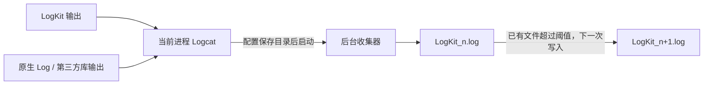

# LogKit

一个使用 Kotlin 编写的 Android 日志工具，提供惰性消息构造、JSON 格式化、UTF-8 长文本分段，以及当前进程 Logcat 日志的本地保存。

日志输出支持简洁的 `LINE` 模式和带边框的 `BORDER` 模式。配置保存目录后，工具会在后台收集当前进程的 Logcat，按文件大小自动轮转，默认阈值为 **5MB（5 × 1024 × 1024 字节）**。

## 功能

- **五种日志等级**：`v`、`d`、`i`、`w`、`e`。
- **惰性消息构造**：通过 Lambda 提供内容，关闭日志或被等级过滤时，不执行 Lambda。
- **两种输出格式**：`LINE` 将线程名放在标签中；`BORDER` 使用边框和线程信息组织内容。
- **JSON 自动识别**：支持 JSON 对象和数组；`LINE` 输出紧凑 JSON，`BORDER` 输出缩进 JSON。
- **多种内容类型**：字符串、数字、布尔值、普通对象以及 `Exception` 异常堆栈。
- **UTF-8 长日志分段**：按字节控制段大小，避免从中文或 emoji 的 UTF-8 编码中间切开。
- **当前进程日志收集**：保存符合等级要求的 Logcat 输出，包括原生 `android.util.Log` 和同进程第三方库的日志。
- **本地文件轮转**：使用 `LogKit_1.log`、`LogKit_2.log` 等文件保存日志。

## 项目结构

```text
LogKit/
├── logkit/    日志库：日志输出、格式化、分段及 Logcat 收集
└── app/       示例应用：使用示例与启动自测
```

最低支持 **Android 11 / API 30**。`1.0.0` 的 AAR 要求接入应用使用 **Compile SDK 37 或更高版本**。

## 接入

在项目的 `settings.gradle.kts` 中配置仓库：

```kotlin
dependencyResolutionManagement {
    repositories {
        google()
        mavenCentral()
    }
}
```

在应用模块的 `build.gradle.kts` 中添加依赖：

```kotlin
dependencies {
    implementation("ink.x2:logkit:1.0.0")
}
```

使用发布版本时，无需复制 `logkit` 源码或添加 `include(":logkit")`。

如果需要修改库源码，可以克隆本仓库，将 app 中的 `implementation(libs.logkit)` 改为
`implementation(project(":logkit"))`；本仓库已包含该模块。

## 快速使用

### 只输出 Logcat

不配置保存目录即可使用日志输出。默认格式为 `BORDER`，也可以先设置为 `LINE`：

```kotlin
import ink.x2.logkit.LogKit

LogKit.init(
    LogKit.Config(
        logType = LogKit.LogType.LINE,
    ),
)

LogKit.v("Demo") { "应用启动" }
LogKit.d("Demo") { "当前状态：ready" }
LogKit.i("Demo") { "加载完成" }
LogKit.w("Demo") { "使用缓存数据" }
LogKit.e("Demo") { IllegalStateException("示例异常") }
```

在主线程上，`LINE` 模式的标签类似 `LogKit-Demo-main`；`BORDER` 模式的标签为 `LogKit-Demo`，线程名单独显示在边框内。可以在 Android Studio Logcat 中使用 `LogKit` 筛选。

### 开启本地保存

建议在应用自己的 `Application.onCreate()` 中初始化一次。保存目录由调用方创建：

```kotlin
import android.app.Application
import android.util.Log
import ink.x2.logkit.LogKit
import java.io.File

class LogKitApplication : Application() {
    override fun onCreate() {
        super.onCreate()

        val logDirectory = File(
            requireNotNull(getExternalFilesDir(null)),
            "logs",
        )
        check(logDirectory.isDirectory || logDirectory.mkdirs()) {
            "无法创建日志目录：${logDirectory.absolutePath}"
        }

        LogKit.init(
            LogKit.Config(
                enable = true,
                minLevel = Log.VERBOSE,
                logFilePath = logDirectory,
                logMaxBuffer = 5L * 1024 * 1024,
                logType = LogKit.LogType.LINE,
                lineSize = 4000,
            ),
        )
    }
}
```

将这个类配置为应用的 `Application`；如果已有自己的 `Application`，将初始化代码放入现有类即可。

```xml
<application android:name=".LogKitApplication">
    <!-- 保留应用现有的 Activity 等配置 -->
</application>
```

初始化后，Activity、ViewModel 等位置直接调用 `LogKit.v/d/i/w/e`，无需重复初始化：

```kotlin
LogKit.v("Demo") { "应用启动，日志同时写入本地文件" }
LogKit.v("LongText") { "中文😀abc".repeat(2000) }
```

这里使用应用专属外部目录，示例应用对应的路径为：

```text
/sdcard/Android/data/ink.x2.demo/files/logs/
```

也可以使用内部目录：

```kotlin
val logDirectory = File(filesDir, "logs")
```

内部目录对应 `/data/user/0/<应用包名>/files/logs/`，与 `/sdcard/Android/data/` 是不同的位置。

## 配置项

| 字段 | 默认值 | 说明 |
| --- | --- | --- |
| `enable` | `true` | 控制 `LogKit.v/d/i/w/e` 是否输出，以及消息 Lambda 是否执行 |
| `minLevel` | `Log.VERBOSE` | 输出等级下限；启动收集器时也用作 Logcat 收集等级 |
| `logFilePath` | `null` | 日志保存目录；未配置时不启动文件收集器 |
| `logMaxBuffer` | `5L * 1024 * 1024` | 单个日志文件的轮转阈值，单位为字节 |
| `logType` | `LogType.BORDER` | 输出格式：`LINE` 或 `BORDER` |
| `lineSize` | `4000` | 分段内容的 UTF-8 字节上限，实际使用值自动限制在 `4..4000` |

`lineSize` 控制消息内容分段，不包含 BORDER 模式额外添加的边框前缀，也不包含 Logcat 的时间和标签等元数据。

收集器运行期间，重复调用 `init()` 会直接返回，新的初始化配置不会应用。

## 内容示例

### 字符串与多行文本

```kotlin
LogKit.d("Text") { "Hello LogKit，中文与 emoji 😀" }
LogKit.d("Text") { "第一行\n第二行\n第三行" }
```

### 数字、布尔值与对象

```kotlin
data class DemoUser(val name: String, val age: Int)

LogKit.d("Value") { 123 }
LogKit.d("Value") { 3.1415926 }
LogKit.d("Value") { true }
LogKit.d("User") { DemoUser(name = "测试用户", age = 18) }
```

普通对象使用 `toString()` 表示，不会自动转换为 JSON。数组也使用其自身的 `toString()`；需要显示元素时，可以在 Lambda 中调用 `contentToString()`。

### JSON

```kotlin
LogKit.d("Json") {
    """{"name":"demo","items":[1,2,3]}"""
}

LogKit.d("JsonArray") {
    """[{"id":1},{"id":2}]"""
}
```

有效 JSON 会按所选模式格式化；无法解析的内容按普通字符串输出。

### 异常

```kotlin
val failure = IllegalStateException(
    "加载失败",
    IllegalArgumentException("参数无效"),
)
LogKit.e("Failure") { failure }
```

传入 `Exception` 时输出堆栈和原因链。当前对 `Exception` 以外的其他 `Throwable` 使用普通对象的输出方式。

### 长日志

```kotlin
LogKit.v("LongText") { "中文😀abc".repeat(2000) }
```

长文本会拆成多次 Logcat 输出，每段保留完整的 UTF-8 编码。也可以单独使用分段方法：

```kotlin
val chunks: Array<String> = LogKit.splitLog("中文😀abc".repeat(2000))
```

## 本地收集与文件轮转



- 收集器使用当前进程 PID 筛选日志，文件内容采用 `threadtime` 格式，包含时间、PID、TID、等级、标签和消息。
- 没有日志文件时，创建 `LogKit_1.log`；后续继续追加到序号最大的文件。
- 当前文件大小超过阈值后，下一次写入创建新文件。单个文件可能因最后一次追加而略大于 5MB。
- 文件异步保存，日志输出后并不意味着内容已立即写入磁盘。
- 日志目录应专用于日志文件，当前写入实现会扫描其中的普通文件来选择追加目标。

`enable` 和动态修改的 `minLevel` 控制的是 LogKit 包装器输出。已经运行的收集器仍按启动时的等级收集原生日志；将 `enable` 设为 `false` 不会停止收集器。目前没有公开的收集器停止或重启接口。

当前没有按文件数量、总容量或保留天数自动清理日志的策略，接入方需要管理历史文件。

## 示例与验证

用 Android Studio 打开项目，选择 `app` 运行。app 使用 Maven Central 的 `ink.x2:logkit:1.0.0`，
由 `LogKitApplication` 在进程启动时初始化一次，`MainActivity` 启动自测。页面显示日志目录、5MB 轮转阈值和各组测试结果：

1. 原生 `Log.v` 收集及 `threadtime` 格式。
2. `LogKit.v` 数据类型与异常输出。
3. LINE / BORDER 输出格式。
4. UTF-8 分段边界及 `lineSize` 范围限制。
5. 长文本、JSON、对象和异常在两种格式下的落盘完整性。
6. 包装器过滤与原生 Logcat 收集的区别。
7. 多线程并发输出。
8. 超过 5MB 后轮转及日志顺序、完整性。

示例会写入超过 5MB 的测试日志以验证轮转，生成的文件保留在页面显示的目录。这里的自测在应用运行时执行，并非运行 JVM 单元测试就会自动执行。

相关代码：

- [LogKitApplication](app/src/main/java/ink/x2/demo/LogKitApplication.kt)
- [MainActivity](app/src/main/java/ink/x2/demo/MainActivity.kt)
- [LogcatTestCases](app/src/main/java/ink/x2/demo/LogcatTestCases.kt)
- [LongLogTestCases](app/src/main/java/ink/x2/demo/LongLogTestCases.kt)

构建 Debug 示例应用：

```shell
./gradlew :app:assembleDebug
```

## 发布到 Maven Central

发布坐标配置为 `ink.x2:logkit:1.0.0`，需要 Central 中的 `ink.x2` 命名空间已验证。

1. 在 [Central User Token 页面](https://central.sonatype.com/usertoken)点击 **Generate User Token**，保存生成的 Username 和 Password。
2. 本机需要 Python 3 和 GnuPG；macOS 可使用 `brew install gnupg` 安装 GnuPG。
3. 在本机终端执行初始化，按提示输入 Token、公开的签名者信息和密钥口令。如果本机已保存 Token，脚本会自动读取：

   ```shell
   python3 scripts/publish.py setup
   ```

   脚本会在本项目的 `.publishing/` 下创建专用密钥环，并将公钥发布到公钥服务器。该目录已被 Git 忽略；不会修改全局 Gradle 或 GPG 配置。签名者名字和邮箱随公钥公开，密钥口令不写入配置文件。请备份该目录并保管口令。

4. 本地构建并核验签名：

   ```shell
   python3 scripts/publish.py check
   ```

5. 上传到 Central：

   ```shell
   python3 scripts/publish.py upload
   ```

   上传后进入 Central 的 **Deployments**，检查校验结果，通过后点击 **Publish**。`upload` 不会自动执行最终发布。同一坐标与版本发布后不能覆盖。

公钥通过服务器的 HTTPS 接口提交，并重新下载核对指纹。上传失败时，本地配置仍保留，可用 `python3 scripts/publish.py publish-key` 重试，无需重复生成密钥。

## 许可证

本项目使用 [MIT License](LICENSE)。
